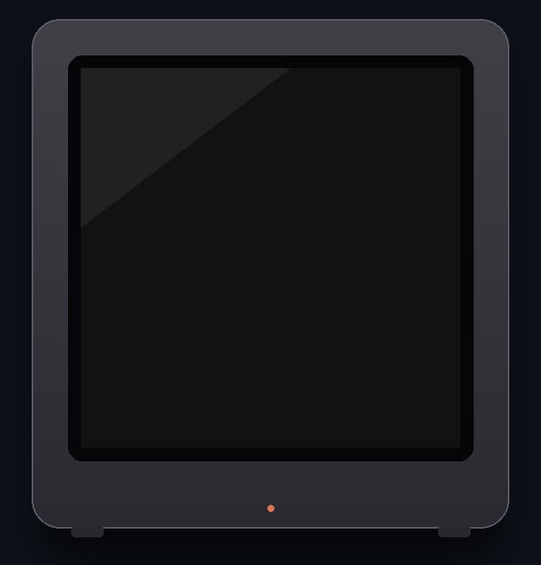
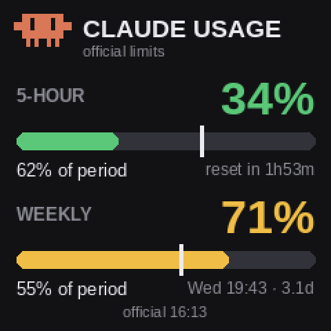
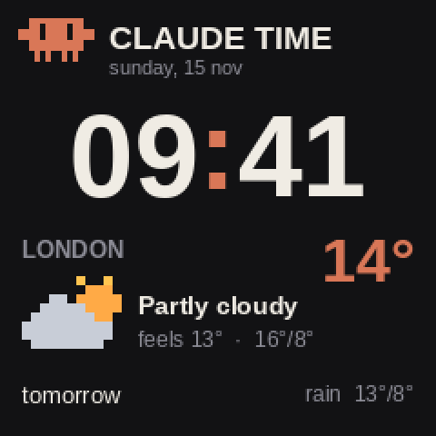
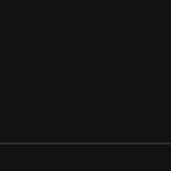
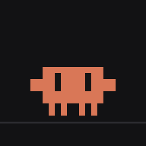
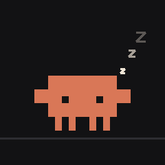

<div align="center">

<picture>
  <source media="(prefers-color-scheme: dark)" srcset="assets/logo-dark.png">
  
</picture>



**Claude, on your desk.**
Your real Claude Code usage against the clock, a pixel critter with moods, and a clock with live weather.
It all runs on a palm-sized GeekMagic SmallTV-PRO with stock firmware.

### [▶ Try the live simulator](https://taflynx.github.io/ccpulse-tv/)

</div>

---

## What's on the screen

| Usage | Clock + weather | Critter | Boot |
|:---:|:---:|:---:|:---:|
|  |  |  |  |
| % used per limit window, with a marker for **how much of the period has passed** | Big clock, your city's weather, feels-like, high/low and tomorrow | Idle, walk, jump, think, sleep | Animated start-up screen |

<p align="center">
  
  
  
  
</p>

**Reading the usage screen.** The bar shows how much of each limit you've used. The white marker shows how far into the period you are.
If the bar passes the marker, you're burning faster than the period allows.

| Color | Meaning |
|---|---|
| 🟢 green | used ≤ elapsed: you're under pace |
| 🟡 amber | used > elapsed: ahead of pace |
| 🔴 red | ≥ 90% used, or more than 25 points ahead of pace |

A `~` after a label means the number is an estimate. That happens when the official endpoint was rate-limited and
[ccpulse](https://github.com/Taflynx/ccpulse) fell back to its calibrated model. The footer shows when the official numbers were last fetched.

**Weather icons** are pixel art in the same style as the critter:


## How it works

```
 ccpulse ──► renderers (Pillow) ──► smalltv.py ──► POST /doUpload ──► SmallTV-PRO
 limits      240×240 JPG / GIF      cron            same name           Picture app,
 % + period                         usage: 10 min   overwrites          autoplay
                                    clock: 1 min
```

The SmallTV-PRO already has a photo-album app and an HTTP upload endpoint. ccpulse-tv renders screens on your own
machine and keeps that album fed. Nothing gets flashed and the firmware isn't modified, and you can undo it from the device's web UI.

## Quick start

You need Python 3 with Pillow, a SmallTV-PRO on your network, and [ccpulse](https://github.com/Taflynx/ccpulse) for the usage screen.

```bash
git clone https://github.com/Taflynx/ccpulse-tv && cd ccpulse-tv
cp config.example.env config.env      # device IP + your city / coordinates / time zone
python3 smalltv.py info               # sanity check: model, firmware, free flash
python3 smalltv.py setup              # upload animations + boot screen, configure the album
python3 smalltv.py cron               # prints two crontab lines: add them with `crontab -e`
```

Then pick **Picture** on the device, or reboot it. `setup` makes Picture the start-up app.

### Commands

| Command | What it does |
|---|---|
| `smalltv.py info` | Model, firmware, free flash, current app |
| `smalltv.py setup` | Render and upload all animations and the boot screen, push usage and clock, set autoplay |
| `smalltv.py usage` | Render the usage screen and push it (cron, every 10 min) |
| `smalltv.py clock` | Render the clock and weather screen and push it (cron, every minute) |
| `smalltv.py ls` / `rm NAME…` / `upload FILE…` | Manage the album |
| `python3 demo.py` | Rebuild every screenshot, GIF and the README demo from sample data |

### Configuration (`config.env` or env vars)

| Variable | Default | |
|---|---|---|
| `SMALLTV_HOST` | none | Device IP (shown on screen at boot) |
| `SMALLTV_INTERVAL` | `20` | Seconds per album item |
| `SMALLTV_GIF_LOOP` | `3` | Times each GIF plays before moving on |
| `WEATHER_CITY` / `WEATHER_LAT` / `WEATHER_LON` / `WEATHER_TZ` | London | Clock and weather location (IANA time zone) |
| `CCPULSE_BIN` | `ccpulse` | Path to the ccpulse binary |

## Things I learned about the SmallTV-PRO (fw V3.3.67)

- **GIFs that look perfect on a PC come out garbled on the device.** Pillow, ezgif and ffmpeg store only the changed rectangle
  of each frame. The device's decoder expects **full 240×240 frames with one global palette**, the way its factory GIFs are built.
  [`clawd.py`](clawd.py) ships a ~40-line LZW encoder that writes exactly that.
- **You can't switch apps over HTTP.** `/set?theme=N` only sets the *start-up* app, and `/set?page=` didn't move it either.
  That's why the clock and weather are drawn as an album image, so everything shares one rotation.
- **Uploading with the same filename overwrites in place.** No delete is needed, and free space stays flat.
- **`/delete` answers `Failed` even when it worked.** `smalltv.py rm` checks the listing instead.
- The web UI has no authentication, and `/.sys/config.json` returns your Wi-Fi credentials to anyone on the LAN. Keep the device on a trusted network.

<details>
<summary>HTTP API reference</summary>

| Endpoint | |
|---|---|
| `POST /doUpload?dir=/image/` | multipart field `file` |
| `GET /filelist?dir=/image/` | HTML table of files |
| `GET /delete?file=/image//NAME` | delete (see quirk above) |
| `GET /set?i_i=SEC&gif_loop=N&autoplay=1` | album settings |
| `GET /set?theme=N` | start-up app (0 Bitcoin, 1 Stocks, 2 Weather, 3 Picture, 4 Monitor, 5 Clock, 6 Ideas) |
| `GET /set?reboot=1` | reboot |
| `GET /v.json`, `/space.json`, `/.sys/app.json` | model, flash, current settings |

</details>

## Project layout

```
smalltv.py        CLI + device API (upload, list, delete, settings)
usage_screen.py   usage screen ← ccpulse pace -j
clock_screen.py   clock + weather screen ← Open-Meteo, pixel-art icons
clawd.py          critter sprite, animations, device-safe GIF encoder
boot.py           boot animation
demo.py           README / GitHub Pages assets from sample data
docs/             GitHub Pages site with the live simulator
fonts/            Liberation Sans (SIL OFL)
```

---

<sub>A personal, unofficial project. It is not affiliated with or endorsed by Anthropic or GeekMagic. "Claude" is a trademark of Anthropic.
Weather data by <a href="https://open-meteo.com/">Open-Meteo</a> (CC BY 4.0). Fonts: Liberation Sans, SIL Open Font License.</sub>
